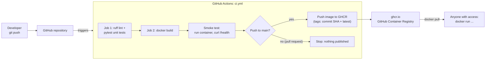
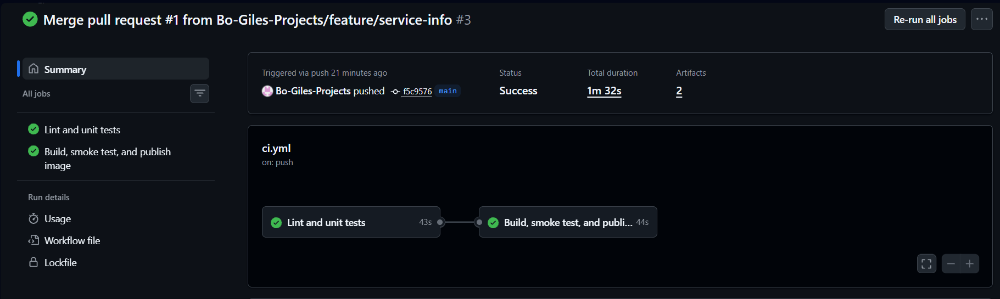
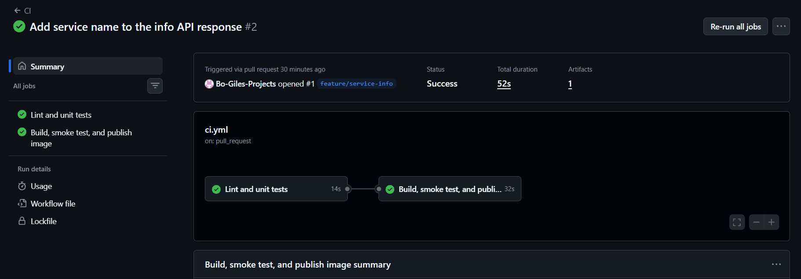
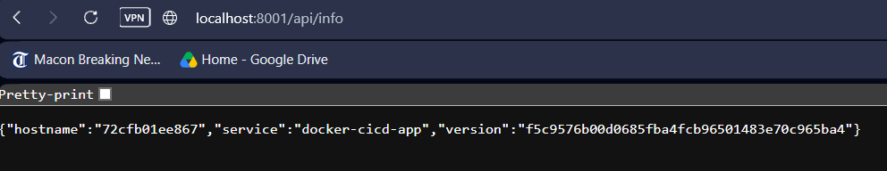

# Dockerized Flask App with a GitHub Actions CI/CD Pipeline

A tiny Python web app, packaged in a **production-style Docker image**, with a **GitHub Actions pipeline** that automatically lints, tests, builds, smoke-tests, and publishes the image to **GitHub Container Registry (GHCR)** on pushes to `main` and pull requests targeting `main`. Checks run for both events; publishing to GHCR runs only on pushes to `main`.

> Built by **Gary "Bo" Giles**, Information Technology student at Georgia Southern University, as the second project in my Cloud & DevOps portfolio.

[](https://github.com/Bo-Giles-Projects/docker-cicd-app/actions/workflows/ci.yml)

**Container image:** `ghcr.io/bo-giles-projects/docker-cicd-app`

---

## What this project shows

- **Containerization:** a multi-stage `Dockerfile` with a slim base image, a non-root user, a `HEALTHCHECK`, and a production server (gunicorn).
- **Continuous Integration (CI):** every push to `main` and pull request targeting `main` is automatically linted (ruff) and unit tested (pytest).
- **Continuous Delivery (CD):** on a push to `main`, the image is published to GHCR, tagged with the commit SHA and `latest`.
- **Smoke testing:** the pipeline starts the real container and checks that `/health` answers before anything is published.
- **Security habits:** least-privilege workflow permissions, no stored passwords (uses the built-in `GITHUB_TOKEN`), non-root container, and an optional Trivy vulnerability scan.

## The app

| Endpoint        | Returns                                                                                                  |
| --------------- | -------------------------------------------------------------------------------------------------------- |
| `GET /`         | A simple HTML homepage                                                                                   |
| `GET /health`   | `{"status": "ok"}`                                                                                       |
| `GET /api/info` | `{"service": "docker-cicd-app", "version": "<APP_VERSION env var>", "hostname": "<container hostname>"}` |

## Architecture



## Project structure

```
docker-cicd-app/
├── app/
│   ├── __init__.py
│   └── main.py                 # The Flask app (3 endpoints)
├── tests/
│   ├── __init__.py
│   └── test_app.py             # pytest unit tests for every endpoint
├── .github/workflows/
│   └── ci.yml                  # The CI/CD pipeline
├── Dockerfile                  # Multi-stage, non-root, healthcheck, gunicorn
├── docker-compose.yml          # One-command local run
├── .dockerignore               # Keeps junk and secrets out of the image
├── .gitignore
├── pyproject.toml              # ruff + pytest settings
├── requirements.txt            # Runtime dependencies (pinned)
├── requirements-dev.txt        # Test/lint tools (pinned)
├── README.md
└── LEARNING.md                 # Line-by-line explanation + interview prep
```

---

## Prerequisites

1. **Git** and your **GitHub account**.
2. **[Docker Desktop](https://www.docker.com/products/docker-desktop/)** (Windows/macOS) or Docker Engine (Linux). After installing, **start it**, then check with `docker --version` and `docker run hello-world`. On Windows, Docker Desktop normally uses WSL 2. Follow its installer prompts.
3. **Python 3.13** (to run tests locally outside Docker): check with `python --version` (on macOS/Linux you may need `python3`).
4. A code editor such as [VS Code](https://code.visualstudio.com/).

---

## Run it locally with Docker

```bash
docker compose up --build
```

Then open <http://localhost:8000>, <http://localhost:8000/health>, and <http://localhost:8000/api/info>. Press `Ctrl+C` to stop, then clean up with:

```bash
docker compose down
```

**Without Compose** (the raw commands Compose is running for you):

```bash
docker build -t docker-cicd-app:local --build-arg APP_VERSION=my-test .
docker run --rm -p 8000:8000 docker-cicd-app:local
```

Useful checks while it's running (in another terminal):

```bash
docker ps                                   # STATUS should become "healthy" after a few seconds
docker exec <container-name> whoami         # prints "app", NOT "root"
```

## Run the tests (no Docker needed)

```bash
python -m venv .venv
source .venv/bin/activate                   # Windows PowerShell: .venv\Scripts\Activate.ps1
pip install -r requirements-dev.txt

ruff check .                                # lint
ruff format --check .                       # formatting check
pytest -v                                   # unit tests
```

---

## How the CI/CD pipeline works

The pipeline lives in [`.github/workflows/ci.yml`](.github/workflows/ci.yml) and runs on every push to `main` and every pull request into `main`.

| Step              | What happens                                                                       | When                             |
| ----------------- | ---------------------------------------------------------------------------------- | -------------------------------- |
| **1. Lint**       | `ruff check` and `ruff format --check` catch style problems and likely bugs        | always                           |
| **2. Test**       | `pytest` runs the unit tests                                                       | always                           |
| **3. Build**      | Docker builds the image (with layer caching)                                       | always, only if steps 1–2 passed |
| **4. Smoke test** | Starts the container and polls `/health` until it answers (fails after 30 seconds) | always                           |
| **5. Log in**     | Logs in to `ghcr.io` using the automatic `GITHUB_TOKEN`                            | push to `main` only              |
| **6. Publish**    | Pushes the image tagged `sha-<full commit SHA>` and `latest`                       | push to `main` only              |

Pull requests run steps 1–4 only, so a broken change is caught **before** it can be merged, and nothing is published from an unreviewed branch.

An optional **Trivy** vulnerability scan is included as a commented-out step in `ci.yml`. Uncomment it to enable it (it's set to non-blocking).

### One-time GitHub setup

1. Create a new **empty** repository on GitHub named `docker-cicd-app` (no README, no `.gitignore`).
2. Push this project to it (see below).
3. No secrets to create. The workflow uses the built-in `GITHUB_TOKEN`, and the `permissions:` block in `ci.yml` grants it permission to write packages.

## Pushing to GitHub

```bash
cd docker-cicd-app
git init
git add .
git commit -m "Dockerized Flask app with GitHub Actions CI/CD"
git branch -M main
git remote add origin https://github.com/Bo-Giles-Projects/docker-cicd-app.git
git push -u origin main
```

Run `git status` before committing and make sure no `.venv/`, `.env`, or key files are listed (`.gitignore` handles this).

## Seeing your image in GHCR

1. Open your **repository** on GitHub. Under **Actions**, open the latest run and confirm both jobs are green.
2. On the repository's main page, look in the right sidebar for **Packages**, and click `docker-cicd-app`. (Or go to your GitHub profile → **Packages** tab.)
3. You'll see the tags: `latest` and `sha-<commit SHA>`.
4. Pull and run your published image:

   ```bash
   docker pull ghcr.io/bo-giles-projects/docker-cicd-app:latest
   docker run --rm -p 8000:8000 ghcr.io/bo-giles-projects/docker-cicd-app:latest
   ```

   If the package is **private**, run `docker login ghcr.io` first (username = your GitHub username, password = a personal access token with the `read:packages` scope). If you want anyone to pull it, open the package's **Package settings** and change the visibility to public. Check the current visibility there rather than assuming.

## Status badge

The badge at the top of this README shows whether the latest CI run on `main` passed.

---

## What I learned

_Fill this in after you get the pipeline green. Interviewers love this section because it shows reflection, not just copying. Prompts to get you started:_

- What is the difference between a Docker **image** and a **container**, in my own words?
- Why does the Dockerfile copy `requirements.txt` and install packages _before_ copying the app code?
- What did my first failed pipeline run look like, and how did I debug it from the logs?
- Why do we use a **multi-stage** build and a **non-root** user?
- Why is the smoke test needed if the unit tests already pass?
- What would I add next? (Examples: deploy the image to a server or Kubernetes, add vulnerability scanning, add a staging environment.)

`[[Write 3–5 sentences here about what surprised you or what you'd do differently.]]`

## Project evidence

- 
- 
- [Merged feature pull request #1](https://github.com/Bo-Giles-Projects/docker-cicd-app/pull/1)
- 

## Next project

The image published here is the starting point for **Project 3**: running it on Kubernetes with monitoring.
