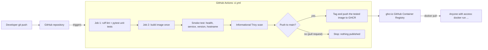

# Dockerized Flask App with a GitHub Actions CI/CD Pipeline

A small Flask app packaged in a Docker image. GitHub Actions lints and tests changes, builds the image once, verifies its health and release metadata, and runs an informational vulnerability scan. On pushes to `main`, the workflow publishes that same tested image to **GitHub Container Registry (GHCR)**.

> Built by **Gary "Bo" Giles**, Information Technology student at Georgia Southern University, as the second project in my Cloud & DevOps portfolio.

[](https://github.com/Bo-Giles-Projects/docker-cicd-app/actions/workflows/ci.yml)

**Container image:** `ghcr.io/bo-giles-projects/docker-cicd-app`

---

## What this project shows

- **Containerization:** a multi-stage `Dockerfile` with a slim base image, a non-root user, a `HEALTHCHECK`, and a production server (gunicorn).
- **Continuous Integration (CI):** every push to `main` and pull request targeting `main` is automatically linted (ruff) and unit tested (pytest).
- **Continuous Delivery (CD):** on a push to `main`, the image is published to GHCR, tagged with the commit SHA and `latest`.
- **Smoke testing:** the pipeline checks `/health` JSON and `/api/info` service, commit version, and hostname, with a 30-second readiness budget and bounded requests.
- **Security habits:** scoped workflow permissions, the built-in `GITHUB_TOKEN`, a non-root container, removal of package installers from the runtime image, and an informational Trivy vulnerability scan.

## The app

| Endpoint        | Returns                                                                                                  |
| --------------- | -------------------------------------------------------------------------------------------------------- |
| `GET /`         | A simple HTML homepage                                                                                   |
| `GET /health`   | `{"status": "ok"}`                                                                                       |
| `GET /api/info` | `{"service": "docker-cicd-app", "version": "<APP_VERSION env var>", "hostname": "<container hostname>"}` |

## Architecture



## Project structure

```
docker-cicd-app/
├── app/
│   ├── __init__.py
│   └── main.py                 # The Flask app (3 endpoints)
├── tests/
│   ├── __init__.py
│   ├── test_app.py             # API behavior tests
│   └── test_smoke_test.py      # Release-check success and failure cases
├── .github/workflows/
│   └── ci.yml                  # The CI/CD pipeline
├── .github/dependabot.yml       # Weekly dependency update proposals
├── scripts/
│   └── smoke_test.py            # Bounded HTTP release verification
├── docs/screenshots/            # Portfolio evidence
├── .gitattributes              # Consistent text line endings
├── Dockerfile                  # Multi-stage, non-root, healthcheck, gunicorn
├── docker-compose.yml          # One-command local run
├── .dockerignore               # Keeps junk and secrets out of the image
├── .gitignore
├── pyproject.toml              # ruff + pytest settings
├── requirements.txt            # Runtime dependencies (pinned)
├── requirements-dev.txt        # Test/lint tools (pinned)
├── README.md
└── LEARNING.md                 # Line-by-line explanation + interview prep
```

---

## Prerequisites

1. **Git** and your **GitHub account**.
2. **[Docker Desktop](https://www.docker.com/products/docker-desktop/)** (Windows/macOS) or Docker Engine (Linux). After installing, **start it**, then check with `docker --version` and `docker run hello-world`. On Windows, Docker Desktop normally uses WSL 2. Follow its installer prompts.
3. **Python 3.13** (to run tests locally outside Docker): check with `python --version` (on macOS/Linux you may need `python3`).
4. A code editor such as [VS Code](https://code.visualstudio.com/).

---

## Run it locally with Docker

```bash
docker compose up --build
```

Then open <http://localhost:8000>, <http://localhost:8000/health>, and <http://localhost:8000/api/info>. Press `Ctrl+C` to stop, then clean up with:

```bash
docker compose down
```

**Without Compose** (the raw commands Compose is running for you):

```bash
docker build -t docker-cicd-app:local --build-arg APP_VERSION=my-test .
docker run --rm -p 8000:8000 docker-cicd-app:local
```

Useful checks while it's running (in another terminal):

```bash
docker ps                                   # STATUS should become "healthy" after a few seconds
docker exec <container-name> whoami         # prints "app", NOT "root"
```

## Run the tests (no Docker needed)

```bash
python -m venv .venv
source .venv/bin/activate                   # Windows PowerShell: .venv\Scripts\Activate.ps1
pip install -r requirements-dev.txt

ruff check .                                # lint
ruff format --check .                       # formatting check
pytest -v                                   # API and release-check tests
```

---

## How the CI/CD pipeline works

The pipeline lives in [`.github/workflows/ci.yml`](.github/workflows/ci.yml) and runs on every push to `main` and every pull request into `main`.

| Step              | What happens                                                                       | When                             |
| ----------------- | ---------------------------------------------------------------------------------- | -------------------------------- |
| **1. Lint**       | `ruff check` and `ruff format --check` catch style problems and likely bugs        | always                           |
| **2. Test**       | `pytest` runs the unit tests                                                       | always                           |
| **3. Build**      | Docker builds the image once (with layer caching)                                       | always, only if steps 1–2 passed |
| **4. Smoke test** | Checks health and release metadata with a 30-second readiness budget | always                           |
| **5. Scan** | Trivy reports high/critical vulnerabilities with available fixes; this scan is informational | always |
| **6. Log in**     | Logs in to `ghcr.io` using the automatic `GITHUB_TOKEN`                            | push to `main` only              |
| **7. Publish**    | Retags and pushes the exact tested image as `sha-<full commit SHA>` and `latest`                       | push to `main` only              |

Pull requests run steps 1–5. On pushes to `main`, steps 6–7 authenticate to GHCR and publish the image that passed the smoke test. No second build occurs. A final cleanup step removes the test container, including after failures.

The **Trivy** scan is informational: vulnerability findings and scan-tool failures do not block publication. Check its logs to distinguish a completed scan from a tool error.

### Dependency maintenance and reproducibility

Dependabot proposes weekly updates for Python dependencies, GitHub Actions, and the Docker base image after its configuration is merged into the default branch. Review and test those proposals before merging.

Direct Python dependencies are pinned. Their transitive dependencies and the mutable `python:3.13-slim` tag are not fully locked, so separate builds can differ. This workflow guarantees that it publishes the image it tested in the same run; a complete dependency lock and base-image digest are future improvements.

### One-time GitHub setup

1. Create a new **empty** repository on GitHub named `docker-cicd-app` (no README, no `.gitignore`).
2. Push this project to it (see below).
3. No secrets to create. The workflow uses the built-in `GITHUB_TOKEN`, and the `permissions:` block in `ci.yml` grants it permission to write packages.

## Pushing to GitHub

```bash
cd docker-cicd-app
git init
git add .
git commit -m "Dockerized Flask app with GitHub Actions CI/CD"
git branch -M main
git remote add origin https://github.com/Bo-Giles-Projects/docker-cicd-app.git
git push -u origin main
```

Run `git status` before committing and make sure no `.venv/`, `.env`, or key files are listed (`.gitignore` handles this).

## Seeing your image in GHCR

1. Open your **repository** on GitHub. Under **Actions**, open the latest run and confirm both jobs are green.
2. On the repository's main page, look in the right sidebar for **Packages**, and click `docker-cicd-app`. (Or go to your GitHub profile → **Packages** tab.)
3. You'll see the tags: `latest` and `sha-<commit SHA>`.
4. Pull and run your published image:

   ```bash
   docker pull ghcr.io/bo-giles-projects/docker-cicd-app:latest
   docker run --rm -p 8000:8000 ghcr.io/bo-giles-projects/docker-cicd-app:latest
   ```

   If the package is **private**, run `docker login ghcr.io` first (username = your GitHub username, password = a personal access token with the `read:packages` scope). If you want anyone to pull it, open the package's **Package settings** and change the visibility to public. Check the current visibility there rather than assuming.

## Status badge

The badge at the top of this README shows whether the latest CI run on `main` passed.

---

## What I learned

- Docker: An image is the packaged app; a container is a running copy.
- Git: You created a branch, committed changes, and pushed them.
- Testing: You updated a test to check the new service field.
- CI/CD: GitHub Actions checked the code, built the container, tested it, and published it after merging.
- Verification: You downloaded the published image and matched its reported version to your Git commit.
- Documentation: You added screenshots and instructions so someone else can understand your work.

Through this project, I practiced packaging and running a Flask application with Docker. I used a Git branch and pull request to add a service field to an API response and updated a test to verify it. I followed how GitHub Actions checks the code, builds and smoke-tests the container, and publishes the image after a merge into main. I also verified the published image by running it locally and matching its version to the merged commit. Documenting the process helped me connect the individual commands to the overall release workflow.

## Project evidence

- 
- 
- [Merged feature pull request #1](https://github.com/Bo-Giles-Projects/docker-cicd-app/pull/1)
- 

## Next project

The image published here is the starting point for **Project 3**: running it on Kubernetes with monitoring.
